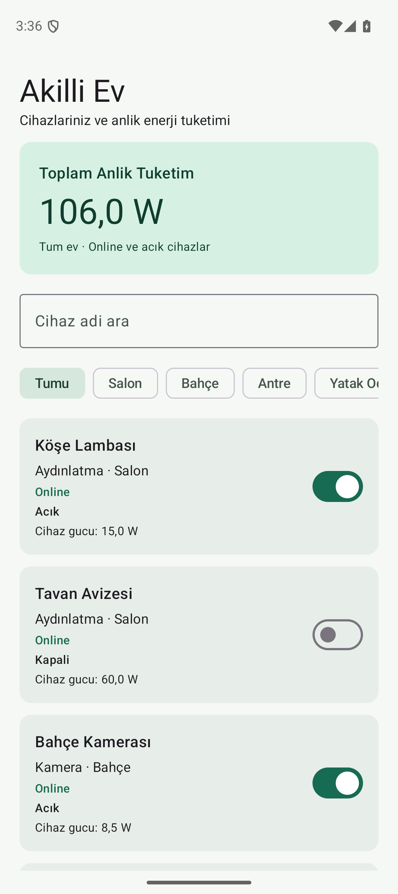
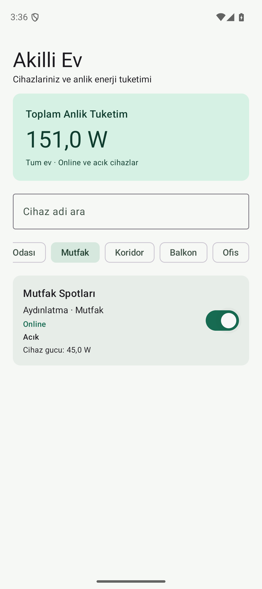

# week3_assignment — Akıllı Ev Kontrol Merkezi

BİL-403 Hafta 3 ödevi. Kotlin, Jetpack Compose / Material 3, Jetpack ViewModel, Coroutines ve StateFlow ile tek ekranlı, bellek içi IoT simülasyonu.

**8 Kasım 2026 son durum** Hızlı arama metninin bozulması düzeltildi. 27 birim/mimari test, 8 UI testi ve üç release arama tekrarı geçti. Son sürekli kaydırma ortalaması **119,13 FPS**. GitHub yayını ve teslim PDF'si son aşamaya ertelendi. [Güncel bulgular](docs/VALIDATION.md).

## Davranış

- Cihaz adına göre, baş/son boşlukları yok sayan ve büyük/küçük harfe duyarsız arama.
- Odaya göre filtre; arama ve oda birlikte **AND** koşuluyla uygulanır.
- Tüm evde yalnızca `isOnline && isOn` cihazların gücünü gösteren reaktif sayaç. Arama ve oda seçimi toplamın kapsamını değiştirmez.
- Cihazı açma/kapatma, listede ve sayaçta reaktif güncelleme oluşturur. Offline cihazın yerel durumu değişebilir, toplam güce katkısı olmaz.

Başlangıç: **10 cihaz, 6 online ve açık cihaz, 106,0 W**. Kayıtlar kaynak ödevdeki sıra ve alanları korur. Ağ, veritabanı, kullanıcı hesabı ve gerçek IoT bağlantısı yoktur. Uygulama işlemi kapanınca başlangıç verilerine dönülür; konfigürasyon değişiminde ViewModel korunur.

## Katmanlar ve veri akışı

```text
Compose callback → HardwareViewModel → InMemoryHardwareRepository
                           ↑                     │
                           └── devices StateFlow ┘
                           │
             combine(devices, query, room)
             filtre + tüm-ev Watt + oda seçenekleri
             flowOn(Default) → stateIn(viewModelScope)
                           │
             ViewModel yayın kapısı
             yeni girdiyi eski sonuçla ezmez
                           │
                           ▼
                  HardwareUiState
                           │
             collectAsStateWithLifecycle
                           ▼
                  Stateless Compose UI
```

```text
week3_assignment/
├── app/build.gradle.kts
├── app/src/main/
│   ├── AndroidManifest.xml
│   └── java/com/example/week3assignment/
│       ├── MainActivity.kt
│       ├── data/
│       │   ├── HardwareItem.kt
│       │   └── InMemoryHardwareRepository.kt
│       └── ui/
│           ├── HardwareUiState.kt
│           ├── HardwareViewModel.kt
│           ├── HardwareViewModelFactory.kt
│           └── HardwareScreen.kt
├── app/src/test/java/com/example/week3assignment/
│   ├── MainDispatcherRule.kt
│   ├── HardwareRepositoryTest.kt
│   ├── HardwareViewModelTest.kt
│   └── ArchitectureRulesTest.kt
├── app/src/androidTest/java/com/example/week3assignment/
│   ├── HardwareScreenTest.kt
│   └── StatelessHardwareScreenTest.kt
├── gradle/wrapper/
├── gradlew / gradlew.bat
├── settings.gradle.kts
└── docs/
    ├── VALIDATION.md
    └── screenshots/
```

**Kural 1:** Model yalnızca `val` alanları olan bir veri sınıfıdır; Compose veya Android UI import'u taşımaz. Repository tek cihaz kaynağıdır; private `MutableStateFlow`, dışarıya `asStateFlow()` sunar. UI `HardwareUiState` ve callback alır; filtreleme, toplama ve yerel iş durumu yoktur. Watt metninin Türkçe biçimlendirilmesi ve kategori etiketi seçimi yalnızca sunumdur. Karttaki “Cihaz gücü” cihazın tanımlı gücüdür; offline/kapalı cihaz için ikinci bir tüketim hesabı yapılmaz.

**Kural 2:** Reaktif türetmeler `stateIn` öncesindeki `flowOn(Default)` üzerinde; toggle ise `viewModelScope.launch` ve Repository içindeki `withContext(Default)` ile çalışır. `MutableStateFlow.update` + `copy` kayıp güncellemeleri önler. UI anahtarlı `LazyColumn` kullanır. Bloklayan IO, `runBlocking`, `Thread.sleep`, yapay gecikme, debounce veya `GlobalScope` yoktur. Testlerde dispatcher constructor ile değiştirilir.

**İlk kare:** Ana iş parçacığında başlangıç filtresi/toplamı da hesaplanmasın diye sabit ödev verisine ait hazır başlangıç durumu (106 W ve oda sırası) kullanılır. Factory yalnızca yeni ViewModel oluştururken yeni Repository verir. Filtrelenmiş liste ve enerji toplamı saf ViewModel fonksiyonundan türetilir. `f01_initialSnapshotMatchesReactiveDerivation` hazır başlangıç durumunun bu türetmeyle bire bir eşit olduğunu doğrular. Seed değişirse bu başlangıç durumu da güncellenmelidir; başlangıçtan önce değiştirilmiş bir Repository enjekte etmek bu sade kurulumun sözleşmesi değildir.

**Metin girişi:** ViewModel, arama metnini ve oda seçimini tek dış `uiState` içinde senkron yayımlar. Böylece TextField girdisi Default üzerindeki filtrelemeyi beklemez. Arkadan gelen türetme yalnızca sorgusu ve odası en güncel girdiye eşitse yayımlanır. Hesap sonuçlanana kadar önceki liste korunur. UI'da ikinci bir metin durumu veya iş hesabı yoktur. `uiState` aboneliği sona erince iç türetme aboneliği kapanır ve `WhileSubscribed(5_000)` hesaplamayı durdurur.

`MainActivity`, `by viewModels { HardwareViewModelFactory() }` ile lifecycle sahibi örneği alır. Factory mevcut ViewModel varsa çağrılmaz; döndürmede yeni Repository ile durumun üzerine yazılmaz. UI akışı `collectAsStateWithLifecycle` ile toplar. `WhileSubscribed(5_000)` abonelik yokken hesaplamayı durdurur; yeniden abone olunduğunda güncel cihaz durumu alınır.

## Çalıştırma

1. Android Studio'da bu kök klasörü açın. Proje adı `week3_assignment` olarak tanımlıdır.
2. SDK Manager'dan Android SDK Platform **37** ve Build Tools **36.0.0** kurulu olsun. Uygulamanın minimum API seviyesi 26, target SDK'sı 36'dır.
3. Gradle JDK olarak **JDK 21** seçin. Daemon yapılandırması bu sürümü kullanır ve bu ortamda JDK 21.0.1 ile doğrulandı. Gradle Sync yapın. İlk senkronizasyon için internet gerekir.
4. Android Studio SDK konumunu `local.properties` içine yazar; terminalde alternatif olarak `ANDROID_HOME` tanımlayın. Makineye özgü bu dosyayı Git'e eklemeyin.
5. Ekranı açık bir emülatör veya USB hata ayıklaması etkin cihaz seçip `app` yapılandırmasını Run ile başlatın.

Sürümler: AGP **9.2.1**, Gradle **9.4.1**, AGP'nin yerleşik Kotlin desteği / Compose compiler **2.2.10**, Compose BOM **2026.02.01**, Lifecycle **2.11.0**, Activity **1.13.0**, Coroutines **1.9.0**. Yerel araç zinciriyle uyumlu sürümler sabitlendi; “en yeni” oldukları iddia edilmez. [AGP uyumluluğu](https://developer.android.com/build/releases/agp-9-2-0-release-notes) ve [yerleşik Kotlin desteği](https://developer.android.com/build/migrate-to-built-in-kotlin).

## Testler

Windows PowerShell, proje kökünde:

```powershell
.\gradlew.bat :app:testDebugUnitTest :app:assembleDebug :app:assembleDebugAndroidTest :app:lintDebug
.\gradlew.bat :app:connectedDebugAndroidTest
```

macOS/Linux üzerinde `./gradlew` kullanın. UI testlerinden önce emülatör ekranı açık ve kilidi kaldırılmış olmalı. Gerekirse `adb shell input keyevent KEYCODE_WAKEUP` ve `adb shell wm dismiss-keyguard` çalıştırın.

- `HardwareViewModelTest`: F-01–F-13, filtre dışında değişen cihazın toplamı güncellemesi, abonelik durup yeniden başlayınca güncel durumu alma. Her test yeni Repository ve ViewModel kullanır; `ViewModelStore.clear()` coroutine kapsamını temizler.
- `HardwareRepositoryTest`: başlangıç verisi, salt okunur akış, eski snapshot'ın korunması, bilinmeyen ID, gerçek Default iş parçacıklarında 2.001 eşzamanlı toggle.
- `ArchitectureRulesTest`: UI iş dönüşümleri / yerel state, katman import sınırları, dispatcher konumu, atomik güncelleme ve lifecycle bağlantısı. Kaynak taraması yardımcı kontroldür; genel bir Kotlin AST analizi değildir ve manuel incelemenin yerine geçmez.
- `HardwareScreenTest`: gerçek Activity üzerinde filtre, boş durum, online/offline toggle, tüm-ev sayacı ve yeniden oluşturma.
- `StatelessHardwareScreenTest`: callback'ler tüketilse bile yeni state verilmeden UI'nin cihaz/oda durumunu kendi başına değiştirmediğini gösterir.

**8 Kasım 2026 kontrolü — 27/27 birim ve mimari test, 8/8 emülatör UI testi geçti.** Debug uygulama, test APK'sı ve R8 etkin release APK derlendi. Lint 0 hata ve 8 uyarı bildirdi. Hızlı metin girişi için iki regresyon testi eklendi. Rapor konumları ve ortam [doğrulama kaydında](docs/VALIDATION.md) yer alır.

## Ekran görüntüleri ve teslim

Testlerde alınmış ekranlar:

| Başlangıç: tüm ev 106,0 W | Mutfak filtresinde tüm ev 151,0 W |
|---|---|
|  |  |

Diğer kanıtlar: [Kamera + Bahçe](docs/screenshots/02-camera-garden.png), [boş sonuç](docs/screenshots/03-empty-result.png), [yatay ekran, korunan 91,0 W ve arama](docs/screenshots/05-landscape.png).

Ekran görüntülerini uygulamayı çalıştırarak alın: başlangıç **106,0 W**, `kamera` + `Bahçe` tek sonuç, `kamera` + `Salon` boş sonuç, `Mutfak` seçiliyken Spotları açınca **151,0 W**. Android Studio Running Devices ekranındaki kamera düğmesi kullanılabilir. Görüntülerde durum çubuğu veya klavye içeriği uygulamayı örtmesin.

Otomatik görüntüleri yeniden üretmek için (emülatör ekranı açıkken):

```powershell
.\gradlew.bat :app:connectedDebugAndroidTest '-Pandroid.injected.androidTest.leaveApksInstalledAfterRun=true'
adb pull /sdcard/Android/data/com.example.week3assignment/files/screenshots docs
```

Teslim için kişisel GitHub hesabınızda `week3_assignment` adlı **Public** repository oluşturun ve kaynakları yükleyin. Wrapper JAR ve betikleri dahil olsun; `.gradle`, `build`, `local.properties` ve makine günlüklerini eklemeyin. Depo bağlantısı ile ekran görüntülerini tek PDF içinde toplayıp dersin ödev alanına süresinde yükleyin. Bu çalışma GitHub yayını veya ödev gönderimi yapmaz.

## Emülatörde 120 FPS testi

**Son tekrar** Arama düzeltmesi içeren APK ile üç sürekli kaydırma ölçümü 118,76 / 119,43 / 119,20 FPS verdi. Birleşik **119,13 FPS**, sunum aralığı p95 değeri 10,20 ms. Üç release arama kontrolü de geçti. [Güncel rapor](docs/performance/emulator-120hz/searchfix-2026-11-08/README.md). Aşağıdaki sayılar önceki APK'ların geçmiş kayıtlarıdır.

8 Kasım 2026'da güncel R8 release APK, **Week3_Pixel9_120Hz** emülatöründe üç kez 30 saniye sürekli kaydırmayla ölçüldü. Android çizim hızı 120 Hz ve uygulamanın kare periyodu 8,33 ms olarak doğrulandı. Birleşik sonuç **109,86 FPS**, sunum aralığı p95 değeri **15,955 ms** oldu. Ek arama kontrolünde `kamera` yerine `kaeram` görüldü. [Güncel release kontrolü](docs/performance/emulator-120hz/submission-2026-11-08/README.md).

Önceki APK ile aynı sürekli dokunma protokolünde **119,70 FPS**, kısa kaydırma protokolünde **116,70 FPS** ölçülmüştü. Farklı protokoller aynı ölçüm gibi karşılaştırılmamalıdır. [R8 karşılaştırması](docs/performance/emulator-120hz/r8-ab/README.md) ve [ilk 103,46 FPS ölçümü](docs/performance/emulator-120hz/README.md) ham izleriyle korunmuştur. Her senaryoda sürdürülebilir 120 FPS doğrulanmış değildir.
